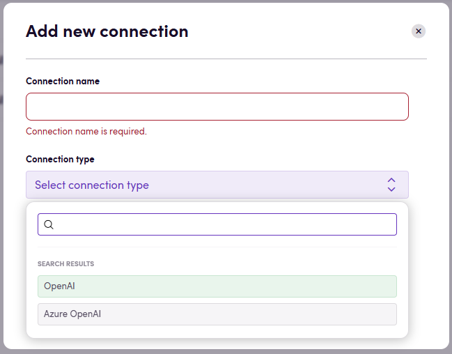
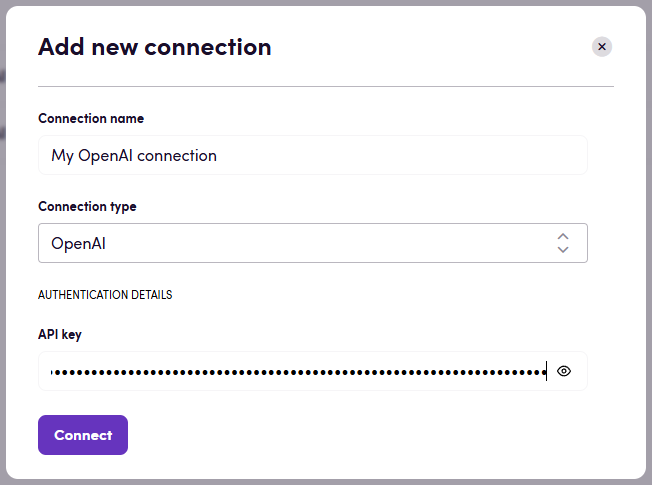
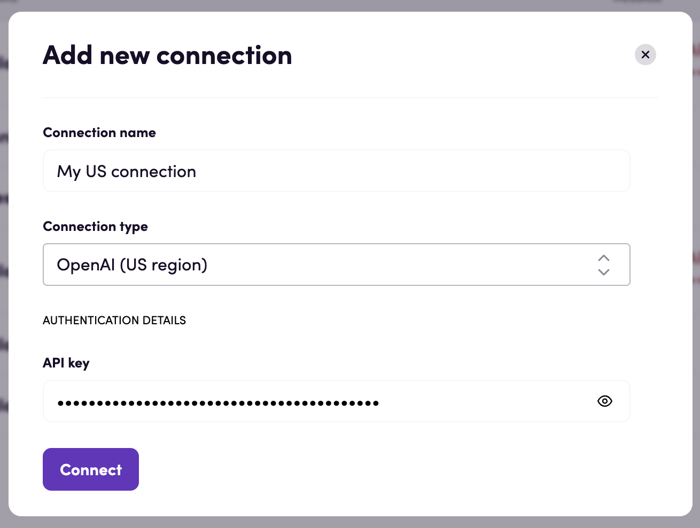
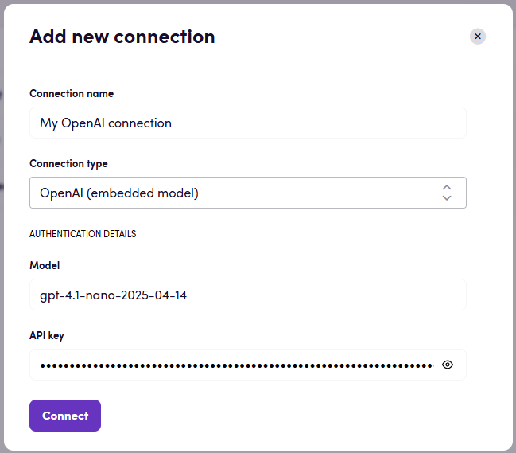
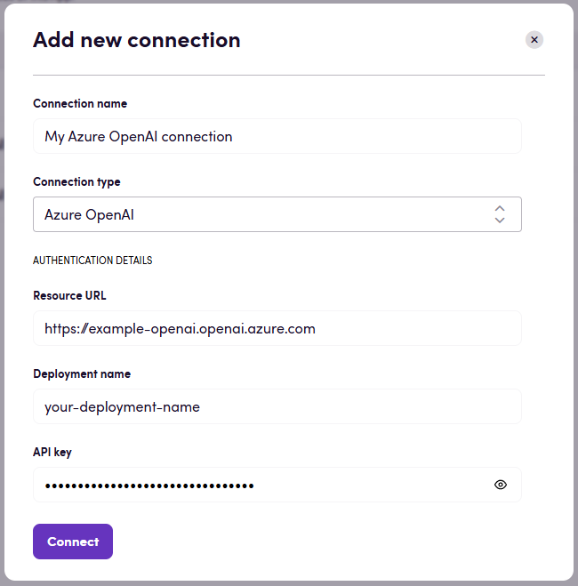
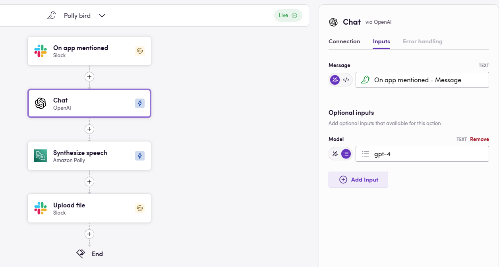

# Blackbird.io OpenAI

Blackbird is the new automation backbone for the language technology industry. Blackbird provides enterprise-scale automation and orchestration with a simple no-code/low-code platform. Blackbird enables ambitious organizations to identify, vet and automate as many processes as possible. Not just localization workflows, but any business and IT process. This repository represents an application that is deployable on Blackbird and usable inside the workflow editor.

## Introduction

<!-- begin docs -->

This OpenAI app in Blackbird gives you access to OpenAI APIs for chat, audio, images, and localization workflows. You can use it with both OpenAI's official API and Azure OpenAI endpoints, using the models available in your account.

The app now uses OpenAI Responses API for text-generation workflows (including chat, translation, editing, review, reporting, and repurposing flows), which enables support for newer model families and built-in tools like web search.

## Before setting up

Before you can connect you need to make sure that:

### For OpenAI actions

- You have an [OpenAI account](https://platform.openai.com/signup).
- You have generated a new `API key` in the [API keys](https://platform.openai.com/account/api-keys) section, granting programmatic access to OpenAI models on a 'pay-as-you-go' basis. With this, you only pay for your actual usage, which [starts at $0,002 per 1,000 tokens](https://openai.com/pricing) for the fastest chat model. Note that the ChatGPT Plus subscription plan is not applicable for this; it only provides access to the limited web interface at chat.openai.com and doesn't include OpenAI API access. Ensure you copy the entire API key, displayed once upon creation, rather than an abbreviated version. The API key has the shape `sk-xxxxxxxxxxxxxxxxxxxxxxxxxxxxxxxxxxxxxxxxxxxxxxxx`.
- Your API account has a payment method and a positive balance, with a minimum of $5. You can set this up in the [Billing settings](https://platform.openai.com/account/billing/overview) section.

**Note**: For standard OpenAI connections, the `Model` input in text-based actions is optional. If you leave it empty, Blackbird resolves the latest compatible general text model automatically. For `OpenAI (embedded model)` connections, the connection model is used by default and can be overridden in the action. For `Azure OpenAI`, the deployment configured in the connection is always used.

### For Azure OpenAI actions

- You have the `Resource URL` for your Azure OpenAI account.
- You know `Deployment name` and `API key` for your Azure OpenAI account.

You can find how to create and deploy an Azure OpenAI Service resource [here](https://learn.microsoft.com/en-us/azure/ai-services/openai/how-to/create-resource?pivots=web-portal).

## Connecting

Navigate to apps and search for OpenAI and click _Add Connection_. This application has three connection types: OpenAI, Azure OpenAI, and OpenAI with an embedded model in the connection. You can select the connection you need from the dropdown menu. Please give your connection a name for future reference, e.g. 'My OpenAI Connection'.

### OpenAI

1. Select `OpenAI` connection type.
2. Fill in your `API key` obtained earlier.
3. Click _Connect_.
4. Verify that connection was added successfully.

### OpenAI (US region)

**Note**: Use this connection type if your OpenAI project has **US data residency** enabled. 
Requests are sent to `https://us.api.openai.com/v1` instead of the global endpoint.

1. Select `OpenAI` connection type.
2. Fill in your `API key` obtained earlier.
3. Click _Connect_.
4. Verify that connection was added successfully.

If you choose `OpenAI (embedded model)` connection type, please specify the model you want to use.

**Note**: The selected model can be overridden in the action using the `Model` input.

### Azure OpenAI

1. Select `Azure OpenAI` connection type.
2. Enter the `Resource URL`, `Deployment name`, and `API key` for your Azure OpenAI account.
3. Click _Connect_.
4. Verify that connection was added successfully.

**Note**: Pay attention to your `Resource URL` connection parameter. Sometimes the correct URL could have some path after a domain name. For example: https://example.openai.azure.com/**openai**

## Actions

Actions are grouped below. Optional inputs are listed as Advanced settings.

## Supported file formats

File-based actions in this app support:

- `.docx`
- `.pptx`
- `.xliff`
- `.html`

When an action exposes **Output file handling** and you select `original`, Blackbird attempts to return the processed file in its original format instead of XLIFF. This applies to actions that actually produce file outputs, such as translation, editing, and review.

### Chat

- **Chat** Outputs a response to a chat message. Advanced settings: **Model**: Select the model to use for OpenAI connections (ignored for Azure OpenAI). **System prompt**: Optional system instruction to guide the response. **Texts**: Texts that will be added to the user prompt along with the message. **File**: Optional file to include (text, image, or audio). **Maximum tokens**: Maximum number of tokens to generate. **Temperature**: Controls randomness in the output. **top_p**: Use nucleus sampling. **Presence penalty**: Penalize new tokens based on whether they appear in the text so far. **Frequency penalty**: Penalize new tokens based on frequency in the text so far. **Reasoning effort**: Controls how much reasoning effort the model applies. **Glossary**: Glossary file to enforce term usage.
- **Chat with system prompt** Outputs a response to a chat message with a required system prompt. Advanced settings: **Image**: Optional image to include with the message.

#### Reasoning effort and sampling parameters

The **Reasoning effort** setting controls reasoning for supported models. Previous documentation stated that an omitted value sends `medium`; verify this against the deployed app and selected model rather than assuming the same behavior for every model. **Verbosity**, where supported, controls the length/detail of model output.

**Temperature** and **top_p** are model-dependent. For GPT-6 family models, OpenAI requires these parameters to be omitted when reasoning effort is not `none`. This compatibility must be handled when the app serializes requests; a blank UI control does not necessarily mean the parameter is omitted. Until verified, avoid configuring custom sampling values for reasoning models. See [OpenAI model guidance](https://developers.openai.com/api/docs/guides/latest-model).

#### Web search (Chat actions)

Optional web search is available in **Chat** and **Chat with system prompt**. When enabled, responses can include **Citations** (URLs cited) and **Sources** (URLs consulted). Optional inputs: **Web search context size** (`low`, `medium`, `high`), **Allow live web access** (when disabled, indexed/cached content only), **Allowed domains** (up to 100), and **User location** (city, ISO-2 country, region, IANA timezone).

Previously documented limitations: no web search for `gpt-4.1-nano`, or for `gpt-5` with `minimal` reasoning effort; this app does not support web search for Azure OpenAI chat connections. Support also depends on the selected model and account. Verify compatibility before enabling in production.

### Translation

- **Translate** Translates file content from a CMS or file storage and outputs localized content for compatible actions. Advanced settings: **Source language**: Override the source language if it is not already set in the file. **Output file handling**: Determine the format of the output file. The default Blackbird behavior is to convert to XLIFF for future steps. **Additional instructions**: Additional instructions to guide the translation. **Bucket size**: Maximum number of source texts to translate at once (default 250, also capped by the model's output limit). **Document summary**: Summarize the document with one extra request and use the summary as context (Auto by default, which summarizes only larger documents). If some segments can't be translated, the action still completes, leaves them untouched and logs a warning.
- **Translate in background** Starts background translation of a file through the OpenAI Batch API and outputs a batch ID and a transformation file to download the result later with **Download background file**. It takes the same inputs as **Translate** and builds the same prompts, glossary context and buckets; only the delivery is asynchronous, at batch pricing. When there is nothing to translate, no batch is created and the batch ID is empty.
- **Translate text** Outputs localized text for the provided input text. Advanced settings: **Source language**: The language of the text. When empty, it is detected with one extra request, so set it when you translate many texts in a loop.

### Editing

- **Edit** Edits translated file content and outputs reviewed content. Advanced settings: **Target language**: Override the target language if it is not already set in the file. **Filter glossary terms**: Filter glossary terms to those present in the content. **Modified by**: Add modified-by metadata to updated units. **Process only segments with this state**: Only segments with this state will be processed. **Max tokens**: The maximum number of tokens to generate in the completion. **Document summary**: Summarize the document with one extra request and use the summary as context (Auto by default, which summarizes only larger documents). If some segments can't be edited, the action still completes, leaves them untouched, logs a warning and lists them in **Error details**.
- **Edit in background** Starts background editing of translated content through the OpenAI Batch API and outputs a batch ID and a transformation file to download the result later with **Download background file**. It takes the same inputs as **Edit**.
- **Edit text** Reviews translated text and outputs an edited version. Advanced settings: **Target audience**: Specify the target audience. **Additional prompt**: Additional prompt to guide editing.
- **Apply prompt to bilingual content (experimental)** Applies your prompt (**System prompt**) to every Initial and Translated segment and outputs the file with updated targets; processed segments are marked Reviewed. The model sees each segment's source and current target and returns only the new target, so sources never change. Glossary, file notes and terms are added as context. Advanced settings: **Process only segments with this state**, **Filter glossary terms**, **Max tokens**, **Bucket size** (default 250, also capped by the model's output limit), **Document summary** (off unless set). Segments the model returns nothing usable for are left untouched and logged as warnings.

### Reporting

- **Create MQM report** Performs MQM analysis for translated text and outputs a report.
- **Create MQM report in background** Starts background MQM analysis for translated file content and outputs a batch ID to download results later.
- **Create MQM report from file** Performs MQM analysis for translated file content and outputs a report.

### Review

- **Get translation issues** Reviews translated text and outputs issue descriptions.
- **Get MQM dimension values** Performs MQM analysis for translated text and outputs per-dimension scores with a proposed translation.
- **Review text** Reviews translated text quality and outputs a quality score. Advanced settings: **top_k**: Only sample from the top K options for each subsequent token.
- **Review** Reviews translated file content and outputs segment quality scores. Advanced settings: **Exclude segment states**: Select one or more states to skip. When omitted or empty, existing Review eligibility is preserved, including skipping Final segments. A nonempty selection replaces the default state restrictions, so Initial/empty and Final can be reviewed unless selected. Missing states count as Initial for exclusions. Ignorable segments and empty targets are always skipped. **Score threshold**: All segments above this score will automatically be finalized (0..1). **Stop sequences**: Sequences that will cause the model to stop generating completion text. **Document summary**: Summarize the document with one extra request and use the summary as context (Auto by default, which summarizes only larger documents). Segments are reviewed in buckets; if some can't be scored, the action still completes and logs a warning. When neither the file nor the input sets a source language, it is detected.

### Background

- **Download background file** Applies the results of a finished **Translate in background** or **Edit in background** job to its transformation file and outputs the file. **Batch ID** is optional, because the transformation file records its batch; **Output file handling** defaults to the choice made when the job was started. Results of an expired or cancelled batch are applied as far as they go. Segments the batch returned nothing usable for are left unchanged, counted in **Unresolved segments** and logged as warnings; they are not retried. Transformation files created by earlier versions of the app still need the batch ID.
- **Get background result** Gets MQM report results from a background batch process.

### Repurposing

- **Summarize text** Summarizes text for different target audiences, languages, tones of voice and platforms. Summaries are shorter than the original text. Advanced settings: **Tone of voice**: Select the tone of voice for the output. **Locale**: Locale for the output language.
- **Summarize** Summarizes content for different target audiences, languages, tones of voice and platforms. Summaries are shorter than the original text.
- **Repurpose text** Repurposes text for different target audiences, languages, tones of voice and platforms. Repurposing does not significantly change the length of the content.
- **Repurpose** Repurposes content for different target audiences, languages, tones of voice and platforms. Repurposing does not significantly change the length of the content.

### Glossaries

- **Extract glossary** Extracts glossary terms from text and outputs a glossary file. Advanced settings: **Name**: Name of the output glossary file.
- **Extract glossary from XLIFF** Extracts glossary terms from XLIFF and outputs a glossary file.

### Audio

- **Create English translation** Translates speech from an audio or video file into English text.
- **Create transcription** Transcribes speech from an audio or video file and outputs text. Advanced settings: **Language (ISO 639-1)**: Language of the audio. **Timestamp granularities**: Return timestamps at the specified granularity (only supported with whisper-1). **Prompt**: Text to guide the model's style or continue a previous audio segment.
- **Create speech** Generates speech audio from input text. Advanced settings: **Output audio name**: The name of the output audio file without the extension. **Response format**: Output audio format. **Speed**: Speech speed multiplier. See **Audio: upcoming migrations** before designing new workflows.

### Images

- **Generate image** Generates an image from a prompt. Advanced settings: **Model ID**: Select an available image generation model. **Output image name**: File name without extension. **Size**: Requested dimensions. **Quality (only for dall-e-3)** and **Style (only for dall-e-3)** are legacy DALL·E controls, not general GPT Image settings. See **Images: model compatibility** below.
- **Get localizable content from image** Extracts localizable text content from an image.
- **Extract localizable content from image** Extracts localizable text from an image and creates an interoperable XLIFF 2.2 file with the original image embedded in its skeleton. If the source language is not provided, it is detected from the image.
- **Generate localized image variant** Restores the original image embedded in a translated XLIFF file and replaces its visible source text using the file's source-to-target mappings.

### Text analysis

- **Create embedding** Generates an embedding vector for input text. Advanced settings: **Model ID**: Select the embedding model to use.
- **Tokenize text** Tokenizes input text and outputs token IDs. Advanced settings: **Encoding**: Tokenizer encoding to use.

### Bucket size, performance and cost

Files can contain a lot of segments. Each action takes your segments and sends them to OpenAI for processing. It's possible that the amount of segments is so high that the prompt exceeds to model's context window or that the model takes longer than Blackbird actions are allowed to take. This is why we have introduced the bucket size parameter. You can tweak the bucket size parameter to determine how many segments to send to OpenAI at once. This will allow you to split the workload into different OpenAI calls. The trade-off is that the same context prompt needs to be send along with each request (which increases the tokens used). For Translate and Edit the default bucket size is 250, and each bucket is also sized so that the response fits within the model's output limit, so you rarely need to change it. Buckets are processed in parallel.

### Temperatures

For models that support custom temperature, the Blackbird UI provides values between 0.0 and 2.0 and these presets. Temperature is **not supported by every model or reasoning mode**; see **Reasoning effort and sampling parameters** above:

- 0.2 Governed: Maximum predictability.
- 0.6 Balanced: A controlled blend of accuracy and flexibility.
- 1.0 Expressive: Accuracy is preserved, structure is looser (UI default when applicable).
- 1.2 Exploratory: Encourages alternative phrasings and ideas while remaining context-aware.
- 1.6 Experimental: Prioritizes creativity over predictability.

### Models and model selection

For standard OpenAI connections, the **Model** input in text-based actions is optional; the app documentation describes selecting a compatible model when this is blank. For **OpenAI (embedded model)** connections, the connection model applies unless overridden in the action. For **Azure OpenAI**, the configured deployment is used. The exact default model selected by a blank text-model input must be verified against the deployed app.

Available models and permitted request parameters change. Consult the [OpenAI model catalog](https://developers.openai.com/api/docs/models), [API deprecations](https://developers.openai.com/api/docs/deprecations), and [Azure OpenAI documentation](https://learn.microsoft.com/en-us/azure/ai-foundry/openai/latest). Explicitly selected model IDs and embedded-model connections do **not** automatically migrate when OpenAI retires a model. Inventory affected Birds and connections; regression-test replacement models for chat, translation, editing, review, and background operations.

Upcoming OpenAI deadlines include `gpt-image-1-mini`, `gpt-image-1.5`, and `chatgpt-image-latest` on **December 1, 2026**, and `gpt-5`, `gpt-5-mini`, `gpt-5-nano`, and `o3` on **December 11, 2026**. Consult the deprecations page for dated variants and other model retirements.

#### Images: model compatibility

The current **Generate image** action source code falls back to `dall-e-3` if **Model ID** is unspecified. OpenAI has retired this model. **Do not rely on a blank Model ID until Blackbird has released and validated an updated default.** Where the action offers a supported model, select it explicitly and test the result. DALL·E-specific quality/style controls should not be assumed compatible with GPT Image models.

Moving the action to a supported GPT Image model, such as `gpt-image-2.6-sunburst` or `gpt-image-2.6-flare`, requires coordinated code, test and deployment changes. Validate supported sizes, request fields, response decoding, and file output; documentation alone cannot migrate the action.

#### Audio: upcoming migrations

OpenAI has announced these shutdown dates for audio models and endpoints documented by this app:

| Model or endpoint | Shutdown date | Migration consideration |
| --- | --- | --- |
| `tts-1`, `tts-1-hd` | January 6, 2027 | Evaluate a supported Realtime speech output flow rather than assuming a drop-in model replacement. |
| `whisper-1` | February 26, 2027 | Evaluate `gpt-transcribe` for file transcription or `gpt-live-transcribe` for live transcription; test formats and timestamps. |
| `/v1/audio/translations` | February 26, 2027 | Evaluate `/v1/realtime/translations`; endpoint and workflow changes may be necessary. |

These are **migration candidates, not claims that the currently deployed Blackbird actions support the replacements**. Test and migrate existing production workflows before their applicable shutdown dates. See [OpenAI API deprecations](https://developers.openai.com/api/docs/deprecations).

### Background processing: batch limits and completion

An OpenAI Batch API input can contain up to **50,000 requests** and **200 MB**. Each request in this app typically corresponds to a bucket of segments. Background actions return a batch ID and, where applicable, a transformation file; use the corresponding background-result action once processing reaches a terminal state.

There are three ways to coordinate completion:

1. **On background job finished** fires when a batch reaches a terminal state. This is a polling event that checks status at the configured interval.
2. **Checkpoints** can pause and resume a Bird around LLM/batch processing. See [Checkpoints for LLMs and batch processing](https://docs.blackbird.io/concepts/checkpoints/#large-language-models-llms--batch-processing).
3. A **Delay** followed by a status check can be useful for simple workflows, but a fixed delay does not establish completion.

Prefer events or Checkpoints to repeated fixed waits when the workflow depends on completion. Terminal outcomes also include failure, expiry, or cancellation; account for partial or missing results.

## Events

### Background

- **On background job finished** Triggered once when a batch job reaches a terminal state (completed, failed, expired or cancelled).

## Example

This simple example how OpenAI can be used to communicate with the Blackbird Slack app. Whenever the app is mentioned, the message will be send to Chat to generate an answer. We then use Amazon Polly to turn the textual response into a spoken-word resopnse and return it in the same channel.

## Actions limitations

- Synchronous actions are subject to the timeout configured in the deployed Blackbird environment. The previously documented 600-second (10-minute) limit requires revalidation; do not assume a 20-minute limit or identical settings across all LLM apps without confirming deployment configuration. For long-running processing, consider the available background actions and Checkpoints.

> OpenAI is sometimes prone to errors. If your Flight fails at an OpenAI step, please check https://status.openai.com/history first to see if there is a known incident or error communicated by OpenAI. If there are no known errors or incidents, please feel free to report it to Blackbird Support.

## Feedback

Feedback to our implementation of OpenAI is always very welcome. Reach out to us using the [established channels](https://www.blackbird.io/) or create an issue.

<!-- end docs -->
